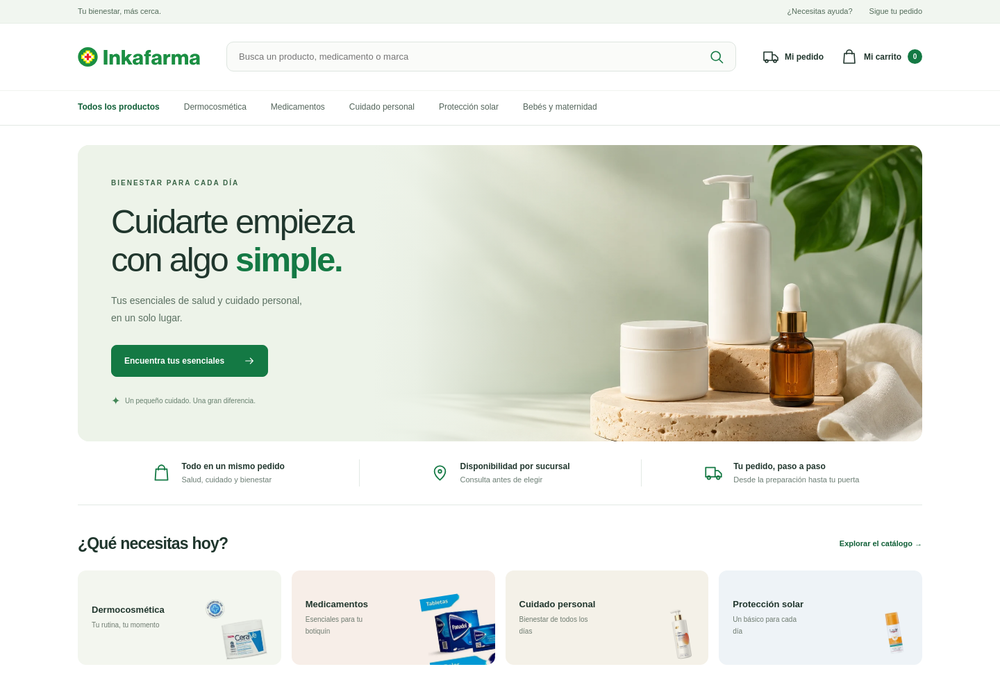
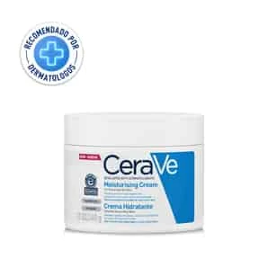
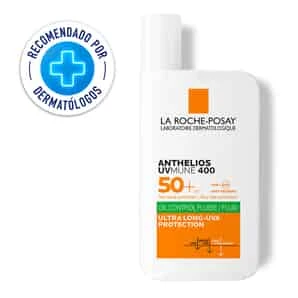
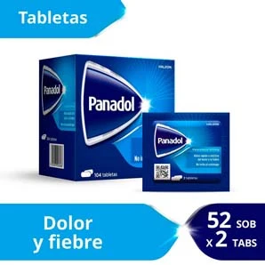

# Inkafarma · Pedidos entre sucursales

Una propuesta para coordinar los pedidos a domicilio entre **Miraflores, San Isidro y Santiago de Surco**. El cliente hace una sola compra y puede consultar su entrega aunque otra sucursal se encargue de prepararla.

[Ver la tienda en móvil](docs/06-evidencias/tienda-comercial-2026-11-13/tienda-390.png) · [Iniciar la aplicación](docs/09-manuales/TECNICO.md) · [Guía de uso](docs/09-manuales/USUARIO.md)

## Del catálogo al carrito

El catálogo reúne 16 productos con fotos, precios en soles y existencias por sucursal. Antes de confirmar, el cliente revisa las cantidades, el costo de envío y el total que pagará al recibir.

| Dermocosmética | Protección solar | Medicamentos |
| :---: | :---: | :---: |
|  |  |  |
| **CeraVe** Crema hidratante · 340 g | **La Roche-Posay** Anthelios UVMune 400 · 50 ml | **Panadol** 500 mg · Caja de 104 tabletas |

[Explorar el catálogo](docs/06-evidencias/tienda-comercial-2026-11-13/catalogo-comercial.png) · [Ver el carrito](docs/06-evidencias/tienda-comercial-2026-11-13/carrito-1440.png)

## Un pedido, de la sucursal a la puerta

1. **Asignación.** Al confirmar la compra, el sistema elige la sucursal más cercana al centro del distrito que tenga todos los productos y capacidad para preparar el pedido. Allí reserva las unidades.
2. **Preparación.** Si la sucursal informa que no puede atenderlo o vence su plazo de aceptación, el sistema busca otra que pueda preparar la compra completa. Si la encuentra, el cliente conserva su código, su dirección y el total confirmado.
3. **Entrega.** Cuando el pedido sale a reparto, las unidades se descuentan del inventario. Con su código, el cliente puede consultar qué sucursal lo atiende y cuándo se registra la entrega.

[Cómo se coordinan las sucursales](docs/LOGISTICA_SUCURSALES.md) · [Documentación del proyecto](docs/README.md)
