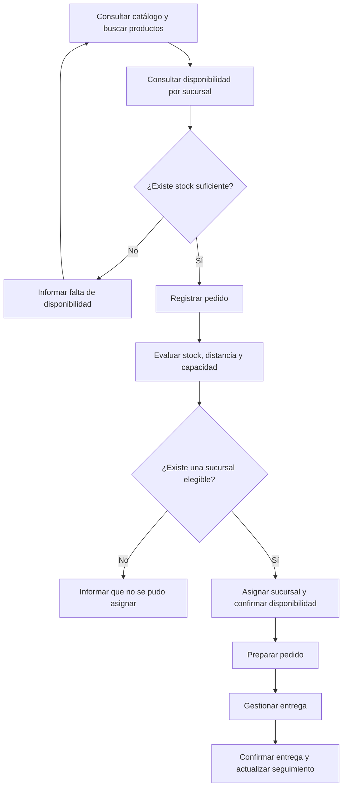

<div align="center">

# 💚 INKAFARMA
### Sistema de Gestión de Pedidos entre Sucursales

**Proyecto académico de Ingeniería de Software**


<br>

[📘 Documentación](docs/) · [📋 Issues](https://github.com/seale-code/Ingenieria-de-software/issues) · [🗂️ Tablero del proyecto](https://github.com/users/seale-code/projects/1)

</div>

---

## 🌿 Sobre nuestro proyecto

**Inkafarma — Sistema de Gestión de Pedidos entre Sucursales** es una propuesta desarrollada para el curso de **Ingeniería de Software de la Universidad Peruana Cayetano Heredia**.

El sistema busca facilitar la consulta de productos y disponibilidad, el registro de pedidos y su asignación a una sucursal de Inkafarma, considerando **stock, distancia y capacidad de atención**. También contempla la preparación, entrega y seguimiento de los pedidos.

El alcance comprende exclusivamente **sucursales de Inkafarma**.

> [!NOTE]
> Proyecto académico no oficial, sin relación comercial con Inkafarma. Las demostraciones utilizarán datos ficticios.

## ✨ Funcionalidades previstas

| Módulo | Funcionalidades |
|:---|:---|
| 🔎 Catálogo y búsqueda | Consultar productos, buscar por nombre y filtrar por categoría. |
| 🏪 Disponibilidad | Consultar stock por sucursal y mostrar productos disponibles. |
| 🛒 Pedidos | Registrar productos y cantidades solicitadas, validando disponibilidad. |
| ⚙️ Asignación de sucursal | Evaluar stock, distancia y capacidad de atención. Las reglas y sus pesos están pendientes de definición. |
| 📦 Preparación y entrega | Gestionar la preparación del pedido, el reparto y la confirmación de entrega. |
| 📍 Seguimiento y soporte | Consultar estados del pedido y registrar incidencias básicas. |

La solución contempla interfaces web y móvil. La cobertura concreta de cada plataforma se acordará según el alcance del MVP.

## 🎯 Objetivos

1. Facilitar la búsqueda de productos y la consulta de disponibilidad por sucursal.
2. Organizar el registro y la asignación de pedidos.
3. Mantener la trazabilidad desde la solicitud hasta la entrega.
4. Validar un flujo completo mediante pruebas y una demostración del MVP.
5. Organizar el trabajo colaborativo mediante **Scrum y GitHub Projects**.

## 🔄 Flujo funcional previsto



*Este flujo representa el comportamiento propuesto; no implica que las funcionalidades estén implementadas.*

## 🏃 Organización con Scrum

El proyecto se divide en **3 sprints**. Las fechas y la duración se acordarán con el equipo.

| Sprint | Objetivo | Resultado esperado |
|:---|:---|:---|
| **Sprint 1** | Catálogo, búsqueda y disponibilidad | Consultar productos y stock por sucursal, con filtros y mensajes sin resultados. |
| **Sprint 2** | Registro y asignación de pedidos | Registrar pedidos y asignarlos a una sucursal según las reglas acordadas. |
| **Sprint 3** | Preparación, entrega y validación | Completar el seguimiento, soporte básico y pruebas del flujo del MVP. |

En cada sprint realizaremos planificación, seguimiento del trabajo, revisión del resultado y una retrospectiva breve.

## 🗂️ Tablero Kanban

Utilizamos un **tablero Kanban como apoyo visual para gestionar los sprints de Scrum**.

### [🚀 Abrir tablero del proyecto](https://github.com/users/seale-code/projects/1)

También está vinculado a la pestaña **Projects** de este repositorio.

| 📝 Por hacer | 🚧 En progreso | 🔎 En revisión | ✅ Terminado |
|:---|:---|:---|:---|
| Actividad pendiente de iniciar. | Actividad en desarrollo. | Trabajo pendiente de revisión y pruebas. | Trabajo revisado y aceptado. |

Las tarjetas se identifican con **[S1]**, **[S2]** o **[S3]**, según su sprint, y el nombre del responsable propuesto.

**Reglas del equipo:**

- Mover las tarjetas manualmente según el avance real.
- Definir un responsable y criterios de aceptación por actividad.
- Revisar y probar el trabajo antes de marcarlo como terminado.
- Registrar bloqueos y coordinar las dependencias entre integrantes.
- Las tarjetas borrador pueden convertirse en Issues de este repositorio para gestionar asignaciones y discusiones.

> El repositorio y el Project tienen permisos de acceso independientes. Cada integrante debe tener acceso a ambos para colaborar.

## 👥 Nuestro equipo

La siguiente distribución es una propuesta inicial; todos colaboran en las revisiones y pruebas.

| Integrante | Enfoque principal | Actividades del Sprint 1 |
|:---|:---|:---|
| **Cesar Milla** | Filtros del catálogo | Filtrar por categoría, sucursal y productos con stock; validar filtros junto con la búsqueda. |
| **Willy CCatamayo** | Interfaz de usuario | Diseñar e implementar pantallas de catálogo, búsqueda y disponibilidad, incluyendo mensajes sin resultados. |
| **Josue Mogollon** | Base de datos | Modelar Producto, Sucursal e Inventario; crear la base de datos y cargar datos ficticios de prueba. |
| **Anderson Delerna** | Backend | Implementar consultas de catálogo, búsqueda por nombre y stock por sucursal. |
| **Sebastian Calderon** | Integración y pruebas | Preparar casos de prueba, conectar las pantallas con los servicios y validar el flujo completo. |

**Curso:** Ingeniería de Software  
**Institución:** Universidad Peruana Cayetano Heredia  
**Metodología:** Scrum con tablero Kanban  
**Cantidad de sprints:** 3

## 📂 Organización del repositorio

| Ruta | Contenido |
|:---|:---|
| [`frontend/`](frontend/) | Interfaz web, pantallas, componentes y conexión con el backend. |
| [`backend/`](backend/) | API, reglas del negocio y acceso a datos. |
| [`database/`](database/) | Modelo de datos, scripts y datos ficticios de prueba. |
| [`tests/`](tests/) | Casos de prueba, pruebas de integración y evidencias. |
| [`docs/`](docs/) | Requisitos, historias de usuario, diagramas y acuerdos del equipo. |
| `README.md` | Presentación y guía general del proyecto. |

Cada carpeta contiene una guía inicial para orientar el desarrollo.

## 🧰 Tecnologías y herramientas

- **Control de versiones:** Git y GitHub.
- **Gestión del trabajo:** GitHub Projects e Issues.
- **Revisión de cambios:** Pull Requests.
- **Frontend, backend y base de datos:** tecnologías pendientes de elección por el equipo.

No se establece todavía un framework o motor de base de datos obligatorio.

## ▶️ Comenzar a trabajar

1. Solicita acceso al repositorio y al Project.
2. Clona el repositorio:

   ```bash
   git clone https://github.com/seale-code/Ingenieria-de-software.git
   cd Ingenieria-de-software
   ```

3. Revisa la documentación de tu carpeta.
4. Selecciona una actividad del sprint y muévela a **En progreso**.
5. Crea una rama para desarrollar el cambio:

   ```bash
   git switch -c feature/descripcion-de-la-tarea
   ```

6. Implementa, prueba y abre un Pull Request para revisión.

Los comandos de instalación y ejecución se documentarán cuando se defina e implemente el stack.

## ✅ Definición de terminado

Una actividad estará terminada cuando:

- Cumpla sus criterios de aceptación.
- Haya sido revisada por otro integrante.
- Supere las pruebas correspondientes.
- Se integre correctamente con las partes relacionadas.
- Incluya la documentación necesaria.
- Pueda demostrarse su resultado.

## 🧭 Estado y hoja de ruta

- [x] Crear el repositorio del equipo.
- [x] Organizar las carpetas iniciales.
- [x] Vincular el tablero a Projects del repositorio.
- [x] Cargar las actividades propuestas de los tres sprints.
- [ ] Completar accesos y asignaciones a cuentas de GitHub.
- [ ] Acordar tecnologías, fechas y criterios de aceptación.
- [ ] Implementar catálogo, búsqueda y disponibilidad.
- [ ] Implementar registro y asignación de pedidos.
- [ ] Implementar preparación, entrega y seguimiento.
- [ ] Validar el MVP y preparar la demostración final.

**Estado actual:** estructura y planificación inicial preparadas. Las funcionalidades del sistema están pendientes de implementación.

---

<div align="center">

### 💚 Tecnología para una gestión más ordenada

**Proyecto académico de Ingeniería de Software • 2026**

*Desarrollado en equipo con Scrum y GitHub Projects.*

</div>

## 📋 PBI y planificación del producto

[Guía Scrum: Product Backlog, priorización, Sprint Backlog y tablero](docs/07-scrum/README.md).
