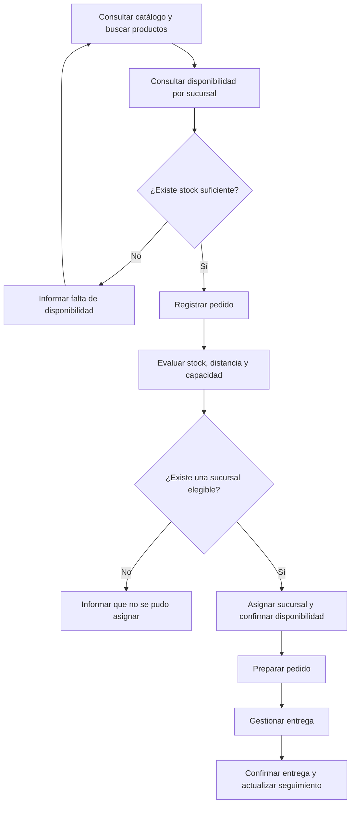

<div align="center">

# 💚 INKAFARMA
### Sistema de Gestión de Pedidos entre Sucursales

**Proyecto académico de Ingeniería de Software**


**Estado: planificación documentada; código pendiente.**


<br>

[📘 Documentación](docs/) · [📋 Issues](https://github.com/seale-code/Ingenieria-de-software/issues) · [🗂️ Tablero del proyecto](docs/07-scrum/tablero-kanban-sprint-1.png)

</div>

---

## Empezar aquí

| Consulta | Documento |
|---|---|
| Qué está listo y qué falta | [Revisión y pendientes](docs/ESTADO_Y_PENDIENTES.md) |
| Documentación en orden | [Índice](docs/README.md) |
| Necesidades del producto | [Historias originales](docs/02-historias-usuario/HistoriasdeUsuario-Inkafarma.pdf) y [Product Backlog](docs/07-scrum/PRODUCT_BACKLOG.md) |
| Prioridades y trabajo del sprint | [MoSCoW](docs/07-scrum/PRIORIZACION.md) y [Sprint Backlog 1](docs/07-scrum/SPRINT_BACKLOG_1.md) |
| Planes | [Sprint 1](sprint-1/README.md) · [Sprint 2](sprint-2/README.md) · [Sprint 3](sprint-3/README.md) |
| Validación | [Casos de prueba](docs/05-pruebas/CASOS_DE_PRUEBA.md) y [evidencias](docs/06-evidencias/README.md) |

**Todavía no hay una aplicación ejecutable.** Las carpetas de código contienen guías; la implementación, instalación y pruebas están pendientes.

## 🌿 Sobre nuestro proyecto

**Inkafarma — Sistema de Gestión de Pedidos entre Sucursales** es una propuesta desarrollada para el curso de **Ingeniería de Software de la Universidad Peruana Cayetano Heredia**.

El sistema busca facilitar la consulta de productos y disponibilidad, el registro de pedidos y su asignación a una sucursal de Inkafarma, considerando **stock, distancia y capacidad de atención**. También contempla la preparación, entrega y seguimiento de los pedidos.

El alcance comprende exclusivamente **sucursales de Inkafarma**.

> [!NOTE]
> Proyecto académico no oficial, sin relación comercial con Inkafarma. Las demostraciones utilizarán datos ficticios.

## ✨ Funcionalidades previstas

| Módulo | Funcionalidades |
|:---|:---|
| 🔎 Catálogo y búsqueda | Consultar productos, buscar por nombre y filtrar por categoría. |
| 🏪 Disponibilidad | Consultar stock por sucursal y mostrar productos disponibles. |
| 🛒 Pedidos | Registrar productos y cantidades solicitadas, validando disponibilidad. |
| ⚙️ Asignación de sucursal | Evaluar stock, distancia y capacidad de atención. Las reglas y sus pesos están pendientes de definición. |
| 📦 Preparación y entrega | Gestionar la preparación del pedido, el reparto y la confirmación de entrega. |
| 📍 Seguimiento y soporte | Consultar estados del pedido y registrar incidencias básicas. |

La solución contempla interfaces web y móvil. La cobertura concreta de cada plataforma se acordará según el alcance del MVP.

## 🎯 Objetivos

1. Facilitar la búsqueda de productos y la consulta de disponibilidad por sucursal.
2. Organizar el registro y la asignación de pedidos.
3. Mantener la trazabilidad desde la solicitud hasta la entrega.
4. Validar un flujo completo mediante pruebas y una demostración del MVP.
5. Organizar el trabajo colaborativo mediante **Scrum, Issues y tablero Kanban**.

## 🔄 Flujo funcional previsto



*Este flujo representa el comportamiento propuesto; no implica que las funcionalidades estén implementadas.*

## 🏃 Organización con Scrum

El proyecto se divide en **3 sprints**. Las fechas y la duración se acordarán con el equipo.

| Sprint | Objetivo | Resultado esperado |
|:---|:---|:---|
| **Sprint 1** | Catálogo, búsqueda y disponibilidad | Consultar productos y stock por sucursal, con filtros y mensajes sin resultados. |
| **Sprint 2** | Registro y asignación de pedidos | Registrar pedidos y asignarlos a una sucursal según las reglas acordadas. |
| **Sprint 3** | Preparación, entrega y validación | Completar el seguimiento, soporte básico y pruebas del flujo del MVP. |

En cada sprint realizaremos planificación, seguimiento del trabajo, revisión del resultado y una retrospectiva breve.

## 🗂️ Tablero Kanban

El tablero del Sprint 1 está guardado como PNG en este repositorio y se muestra aquí mismo.


Las 12 tareas están en **Por hacer**, según la planificación inicial. Las demás columnas son **En progreso**, **En revisión** y **Terminado**. Es una vista estática; actualizar el PNG cuando cambie el avance, después de verificar revisión y pruebas.

[Reglas y detalle del tablero](docs/07-scrum/TABLERO.md) · [Tareas, responsables y PBI](docs/07-scrum/SPRINT_BACKLOG_1.md)

## 👥 Nuestro equipo

La siguiente distribución es una propuesta inicial; todos colaboran en las revisiones y pruebas.

| Integrante | Enfoque principal | Actividades del Sprint 1 |
|:---|:---|:---|
| **Cesar Milla** | Filtros del catálogo | Filtrar por categoría, sucursal y productos con stock; validar filtros junto con la búsqueda. |
| **Willy CCatamayo** | Interfaz de usuario | Diseñar e implementar pantallas de catálogo, búsqueda y disponibilidad, incluyendo mensajes sin resultados. |
| **Josue Mogollon** | Base de datos | Modelar Producto, Sucursal e Inventario; crear la base de datos y cargar datos ficticios de prueba. |
| **Anderson Delerna** | Backend | Implementar consultas de catálogo, búsqueda por nombre y stock por sucursal. |
| **Sebastian Calderon** | Integración y pruebas | Preparar casos de prueba, conectar las pantallas con los servicios y validar el flujo completo. |

**Curso:** Ingeniería de Software  
**Institución:** Universidad Peruana Cayetano Heredia  
**Metodología:** Scrum con tablero Kanban  
**Cantidad de sprints:** 3

## 📂 Organización del repositorio

| Ruta | Contenido |
|:---|:---|
| [`src/frontend/`](src/frontend/) | Interfaz web, pantallas, componentes y conexión con el backend. |
| [`src/backend/`](src/backend/) | API, reglas del negocio y acceso a datos. |
| [`src/database/`](src/database/) | Modelo de datos, scripts y datos ficticios de prueba. |
| [`tests/`](tests/) | Casos de prueba, pruebas de integración y evidencias. |
| [`docs/`](docs/) | Requisitos, historias de usuario, diagramas y acuerdos del equipo. |
| `README.md` | Presentación y guía general del proyecto. |

Cada carpeta contiene una guía inicial para orientar el desarrollo.

## 🧰 Tecnologías y herramientas

- **Control de versiones:** Git y GitHub.
- **Gestión del trabajo:** Issues y tablero Kanban en PNG dentro del repositorio.
- **Revisión de cambios:** Pull Requests.
- **Propuesta de arranque:** HTML/CSS/JavaScript, Python con Flask y SQLite.

La propuesta técnica aún no tiene código ni configuración en el repositorio. La arquitectura, las versiones y los comandos se documentarán al iniciar la implementación.

## ▶️ Comenzar a trabajar

1. Solicita acceso al repositorio.
2. Clona el repositorio:

   ```bash
   git clone https://github.com/seale-code/Ingenieria-de-software.git
   cd Ingenieria-de-software
   ```

3. Revisa la documentación de tu carpeta.
4. Selecciona una actividad del sprint y muévela a **En progreso**.
5. Crea una rama para desarrollar el cambio:

   ```bash
   git switch -c feature/descripcion-de-la-tarea
   ```

6. Implementa, prueba y abre un Pull Request para revisión.

Los comandos de instalación y ejecución se documentarán cuando se defina e implemente el stack.

## ✅ Definición de terminado

Una actividad estará terminada cuando:

- Cumpla sus criterios de aceptación.
- Haya sido revisada por otro integrante.
- Supere las pruebas correspondientes.
- Se integre correctamente con las partes relacionadas.
- Incluya la documentación necesaria.
- Pueda demostrarse su resultado.

## 🧭 Estado y hoja de ruta

- [x] Crear el repositorio del equipo.
- [x] Organizar las carpetas iniciales.
- [x] Guardar y mostrar el tablero Kanban del Sprint 1 en PNG.
- [x] Cargar las actividades propuestas de los tres sprints.
- [ ] Completar accesos y asignaciones a cuentas de GitHub.
- [ ] Acordar tecnologías, fechas y criterios de aceptación.
- [ ] Implementar catálogo, búsqueda y disponibilidad.
- [ ] Implementar registro y asignación de pedidos.
- [ ] Implementar preparación, entrega y seguimiento.
- [ ] Validar el MVP y preparar la demostración final.

**Estado actual:** estructura y planificación inicial preparadas. Las funcionalidades del sistema están pendientes de implementación.

---

<div align="center">

### 💚 Tecnología para una gestión más ordenada

**Proyecto académico de Ingeniería de Software • 2026**

*Desarrollado en equipo con Scrum y tablero Kanban.*

</div>
