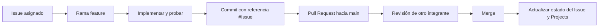

# Tablero Kanban de Sprint 02 — Snapshot documental

**Última consulta de referencia:** 30 de octubre de 2026. Los estados de GitHub pueden cambiar. **No es un tablero automático.**

| Código | Responsable | Issue | Estado / evidencia observada | Acción pendiente a verificar |
|---|---|---|---|---|
| S2-01 | Cesar Milla | [#9](https://github.com/seale-code/Ingenieria-de-software/issues/9) | PR #34 integrado según plan del repositorio | Confirmar aceptación del equipo |
| S2-02 | Willy CCatamayo | [#20](https://github.com/seale-code/Ingenieria-de-software/issues/20) | Pendiente según plan documentado al 29/10 | Presentar formulario y pruebas web |
| **S2-03** | **Josue Mogollon** | [#21](https://github.com/seale-code/Ingenieria-de-software/issues/21) | **Issue cerrado; PR #44 abierto**; 32 pruebas locales específicas OK | Obtener revisión y merge del PR #44 |
| S2-04 | Anderson Delerna | [#18](https://github.com/seale-code/Ingenieria-de-software/issues/18) | PR #37 integrado según el plan | Validar documentación, cierre de Issue |
| S2-05 | Sebastian Calderon | [#12](https://github.com/seale-code/Ingenieria-de-software/issues/12) | Entrega técnica documentada: 120 pruebas del 29/10 | Revisión y aceptación del equipo |

## Flujo de GitHub vinculado al trabajo

### Trazabilidad especial de Josue

| Elemento | Referencia |
|---|---|
| Tarea | S2-03 — modelar pedidos, detalles y reservas |
| Issue | [#21](https://github.com/seale-code/Ingenieria-de-software/issues/21) |
| Rama | `feature/josue-sprint2-pedidos` |
| PR | [#44](https://github.com/seale-code/Ingenieria-de-software/pull/44) |
| Commit reportado en PR | `5b059fc` |
| Pruebas locales reportadas | `test_josue_migrations.py`: 12 OK; `test_pedidos_s2.py`: 20 OK |
| Criterio por validar | Aprobación del revisor y merge |

## Observaciones de control

1. El documento original de [`sprint-2/README.md`](../../sprint-2/README.md) registra estados anteriores al cierre del Issue #21: **la fuente prioritaria para el estado actual es GitHub**.
2. El cierre del Issue puede ocurrir al mover la tarjeta a Done, sin que el PR esté integrado; conviene verificar la política del equipo.
3. Si se incorporan estas carpetas a la rama de Josue, **el PR #44 se actualizará automáticamente**, no se requiere crear un segundo PR.
