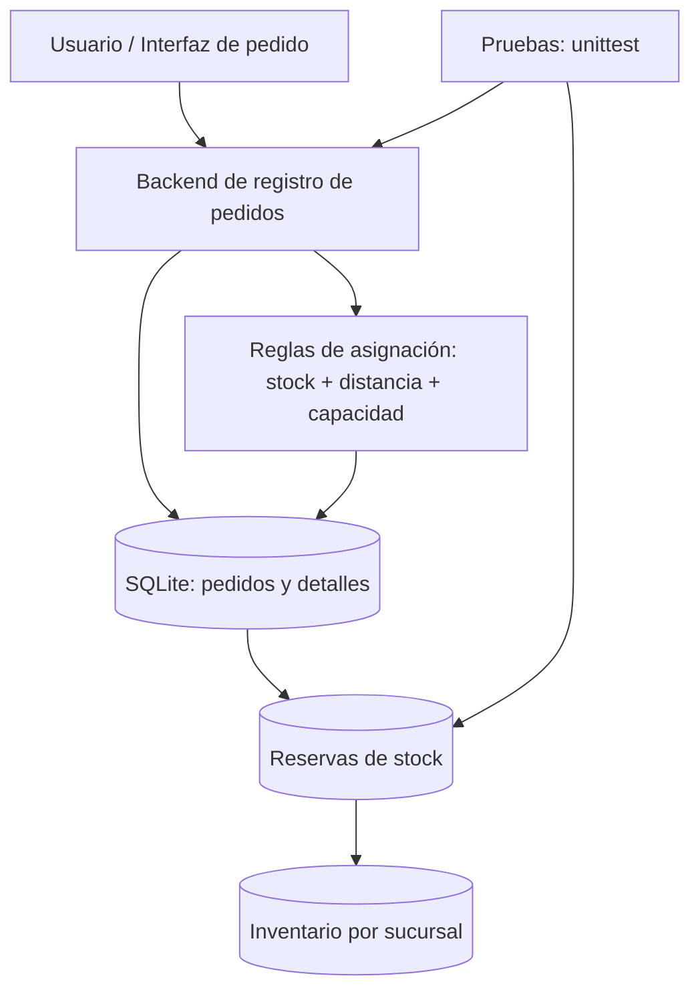

# Arquitectura y ejecución técnica del Sprint 02

## Diagrama de componentes (resumen documental)



## Tablas oficiales citadas en la documentación del proyecto

- `pedidos`: entidad central de la solicitud.
- `detalles_pedido`: productos y cantidades pertenecientes a un pedido.
- `reservas_stock`: compromiso de unidades por producto/sucursal/pedido, incluyendo estados.
- `inventario`: stock físico que sirve para calcular disponibilidad.

**Regla esencial:** la cantidad disponible se calcula restando reservas ACTIVAS al inventario físico. Reservar **no** reduce todavía el inventario físico; consumir la reserva lo reduce una sola vez. La implementación concreta se define en los SQL de migración y el puente oficial. No modificar tablas de forma incompatible con el Sprint 1.

## Flujo transaccional resumido

1. Validar cliente, localización, códigos y cantidades.
2. Agrupar líneas repetidas y determinar sucursales elegibles.
3. Calcular disponibilidad descontando reservas activas y aplicar reglas.
4. Guardar pedido, detalles y reservas en una transacción atómica; si falla, deshacer todo.
5. Responder con sucursal elegida o un motivo de imposibilidad.

## Ejecución reproducible — PowerShell desde la raíz del repositorio

> Comandos de demostración, no exigen acceder a datos de producción. Se crea una BD de datos ficticios independiente. Ejecutar después de revisar dependencias y rutas.

```powershell
New-Item -ItemType Directory -Path .test-tmp -Force | Out-Null
py -m src.database init --demo --db .test-tmp/s2-demo-josue.sqlite3
py -m src.database.migrate_josue --db .test-tmp/s2-demo-josue.sqlite3 --hasta 2
py -m src.backend.pedidos_s2_cli --db .test-tmp/s2-demo-josue.sqlite3 init
py -m src.backend.pedidos_s2_cli --db .test-tmp/s2-demo-josue.sqlite3 capacidad --sucursal DEMO-NORTE --max-pedidos 10
py -m src.backend.pedidos_s2_cli --db .test-tmp/s2-demo-josue.sqlite3 registrar --cliente "Cliente ficticio" --lat -12 --lon -77.05 --item DEMO-A:2
```

Para consultar, sustituir `<id_generado>` por el ID real mostrado en `registrar`:

```powershell
py -m src.backend.pedidos_s2_cli --db .test-tmp/s2-demo-josue.sqlite3 consultar --pedido <id_generado>
```

## Pruebas

```powershell
py -m unittest discover -s tests -p "test_josue_migrations.py" -v
py -m unittest discover -s tests -p "test_pedidos_s2.py" -v
py -m unittest discover -s tests -v
```

## Rama / Pull Request

- Rama de Josue: `feature/josue-sprint2-pedidos`.
- PR: [#44 — corrección y validación de pedidos y reservas](https://github.com/seale-code/Ingenieria-de-software/pull/44).
- Issue: [#21 — modelar pedidos, detalles y reservas](https://github.com/seale-code/Ingenieria-de-software/issues/21).

**No mezclar** los cambios de esta documentación con modificaciones a `main` fuera del flujo de revisión.
