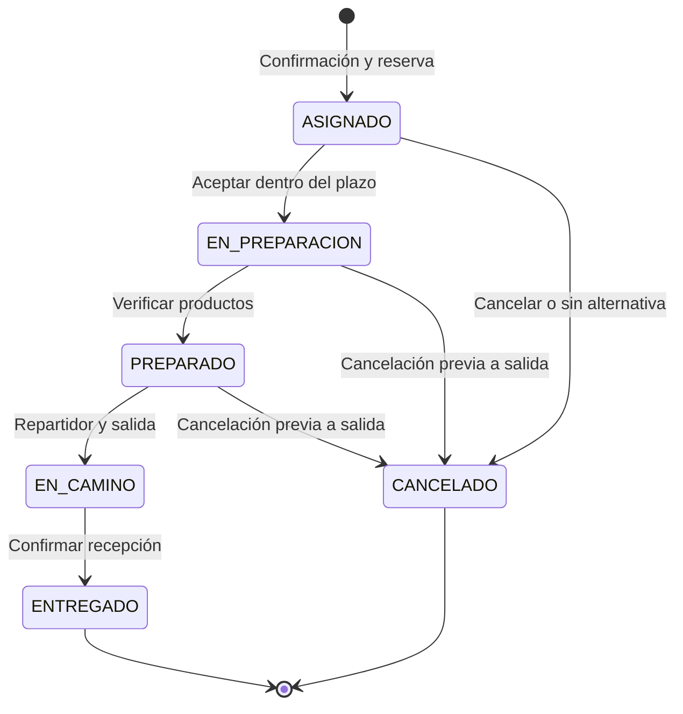

# Flujo implementado del pedido (v6)

[Logística](../LOGISTICA_SUCURSALES.md) · [Precios](../CATALOGO_COMERCIAL.md) · [Datos](MODELO_DATOS.md)

## Confirmación

El cliente obtiene cotización y confirma con UUID, dirección, teléfono y distrito. Una transacción comprueba productos, precio, stock completo y capacidad y persiste pedido, líneas, reservas y precios. Cambio de precio o falta de sucursal no deja escrituras parciales. El reintento válido recupera el mismo pedido.

`REGISTRADO` permanece admitido por compatibilidad; el formulario crea `ASIGNADO`. Una fecha aislada del módulo anterior no equivale a una transición integral.

## Reasignación

| Disparador | Operación atómica | Resultado |
|---|---|---|
| Plazo vencido sin aceptación | Liberar origen, evaluar alternativas, registrar incidencia/historial y reservar destino | ASIGNADO en destino con nuevo plazo. |
| Incapacidad declarada durante asignación/preparación | Mismo proceso con motivo y generación esperada | Si estaba EN_PREPARACION, vuelve a ASIGNADO. |
| No existe alternativa completa con capacidad | Liberar, cerrar pedido y resolver incidencia con el resultado | CANCELADO. |

Se conservan código, dirección, cantidades e importes; se actualizan sucursal/distancia. Las reservas liberadas se mantienen. No se vuelve a sucursales intentadas. La preparación aceptada queda fuera del vencimiento; no se reasigna un pedido preparado o con entrega asignada.

Al salir se consume la reserva y se genera una sola salida de inventario. Repetir salida/recepción no duplica efectos. Cancelar libera sin descontar físico y se bloquea después de la salida. El mismo código permite seguir el pedido; los avisos se consultan en web, sin envío externo.
