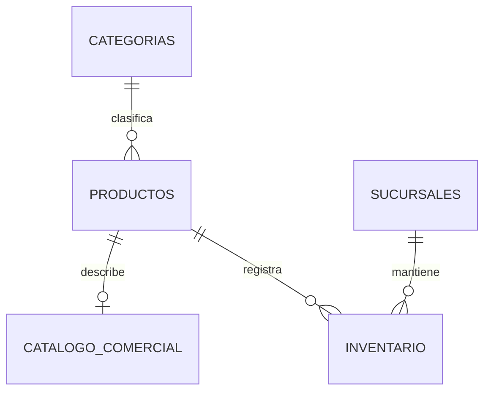
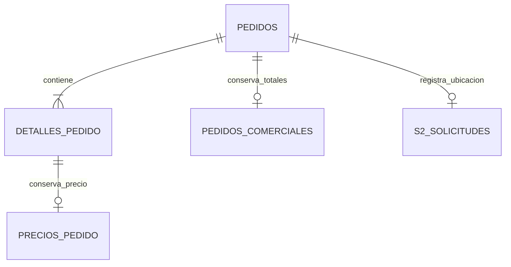
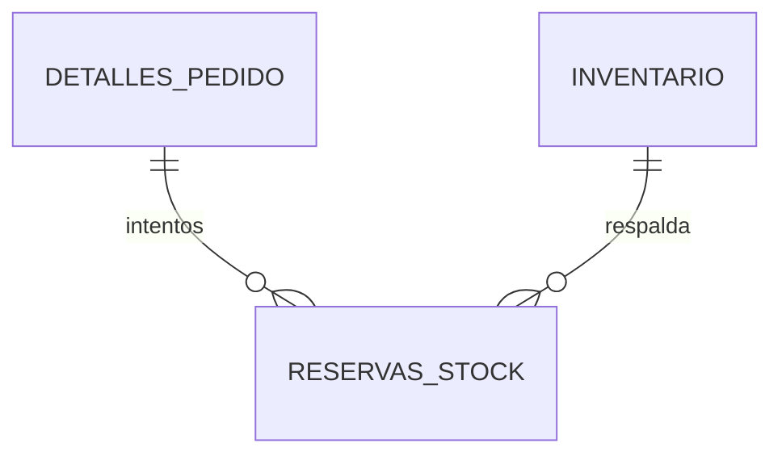
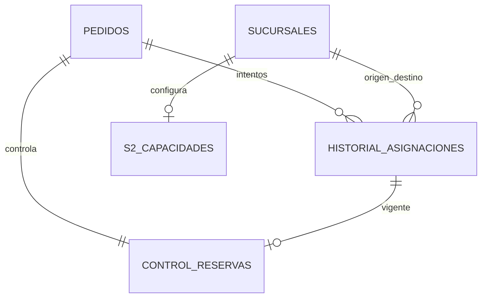
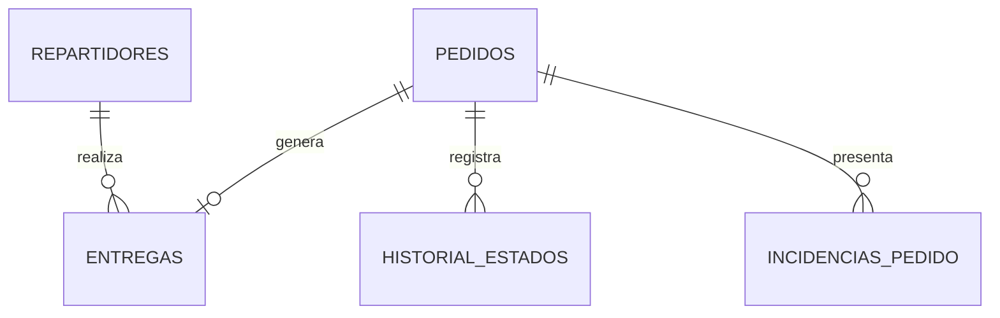
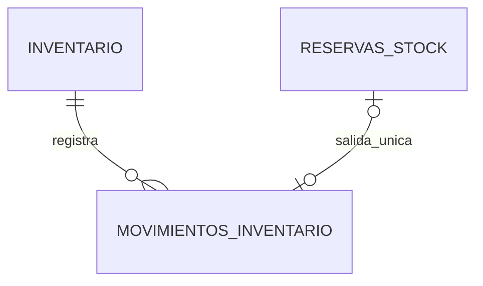

# Modelo de datos implementado — v6

[Diccionario completo](DICCIONARIO_DATOS_V6.md) · [Migraciones](../../src/database/migrations) · [Logística](../LOGISTICA_SUCURSALES.md)

Base funcional `53b6ff8`. SQLite mantiene 20 tablas, claves foráneas habilitadas, `application_id=1229867841` y `user_version=6`. Las vistas se dividen por responsabilidad para mantener legibilidad; las relaciones exactas y campos están en el diccionario generado.

## Catálogo y existencias

`inventario` identifica el par producto/sucursal, no un stock global. El catálogo público v5/v6 limita sus resultados a productos con metadatos comerciales. El disponible se calcula; no se almacena un segundo saldo susceptible de desincronización.

## Pedido e importes

La cardinalidad de detalle obligatorio es de negocio: el encabezado se crea antes de las líneas dentro de la misma transacción. Pedidos previos pueden no tener datos comerciales. Los nuevos pedidos de la tienda guardan precio unitario/cantidad y totales en céntimos; contacto/dirección se conservan solo en las consultas autorizadas.

## Reservas históricas

Una línea tiene **varios intentos históricos**, no una relación 0..1 global. El índice parcial permite solo una reserva ACTIVA o CONSUMIDA por pedido/producto. Una LIBERADA se conserva y permite un nuevo intento.

La FK de reserva hacia pedido es `pedido_id → pedidos.id`. La antigua FK compuesta `(pedido_id,sucursal_id) → pedidos` se reemplazó en v6: una reserva histórica debe seguir indicando la sucursal de origen aunque cambie la sucursal vigente del pedido. El trigger de inserción exige que toda reserva nueva corresponda a la sucursal actual y al detalle.

## Asignación y aceptación

Origen/destino pueden ser nulos según el evento: inicialmente no hay origen; sin alternativa no hay destino. `asignacion_anterior_id` referencia otro evento y es único para impedir dos resoluciones del mismo intento. `control_reservas` conserva la generación, el límite y la aceptación. `politica_reservas` es una configuración singleton, sin FK: establece el plazo de futuras asignaciones.

## Reparto y soporte

Una entrega por pedido. Las fechas no sustituyen al estado: el servicio integrado cambia fecha, pedido, entrega, reserva, stock e historial en una transacción. El historial se genera mediante triggers y no se edita/borrar. Incidencias avanza ABIERTA → EN_REVISION → RESUELTA y exige resolución.

## Movimientos de inventario

El movimiento de salida exige una reserva consumida y tiene `reserva_id` único. Apertura/entrada/ajuste no tienen reserva. El registro del movimiento aplica el saldo mediante trigger, sin una segunda escritura manual del servicio. Se rechazan cambios ordinarios de saldo sin movimiento, reservas mayores al físico y ajustes por debajo de lo reservado. Un UUID evita repetir entradas/ajustes; el conteo exige saldo esperado para evitar sobrescribir una actualización concurrente.

## Migraciones y conservación

| Versión | Aporte |
|---|---|
| 1 | Categorías, productos, sucursales e inventario. |
| 2 | Pedidos, detalles y reservas. |
| 3 | Repartidores, entregas e historial. |
| 4 | Incidencias. |
| 5 | Metadatos comerciales, contacto/totales y precios por línea. |
| 6 | Reservas históricas, política/control/historial de asignación y movimientos. |

`s2_solicitudes` y `s2_capacidades` se inicializan con el módulo de pedidos. El arranque aplica migraciones y ese módulo. No se deshabilitan FK ni se repone inventario operado al reiniciar. La migración crea un saldo de apertura del físico existente; no inventa salidas históricas.

El [modelo de Josue de S2/S3](../MODELO_DATOS_JOSUE_S2_S3.md) se conserva como evidencia de esas versiones; para el esquema vigente prevalece este documento.

## Extensión de seguridad de la tienda

La fábrica de la aplicación añade cinco tablas a las veinte del esquema de negocio v6. La instalación es idempotente sobre bases existentes. Las copias completas de SQLite incluyen estas tablas.

| Tabla | Relación y finalidad |
|---|---|
| operadores | Identidad individual. La sucursal referencia su código. Un valor nulo indica la central. |
| auditoria_operaciones | Usuario, ruta, acción, fecha y respuesta de la escritura. El nombre queda registrado tras la baja de la cuenta. |
| verificaciones | UUID del pedido, teléfono, vencimiento, firma del código e intentos. |
| ventanas | Clave derivada, contador y vencimiento compartidos entre workers. |
| plazos_compra | Un plazo total por pedido verificado, enlazado a pedidos.id. |
