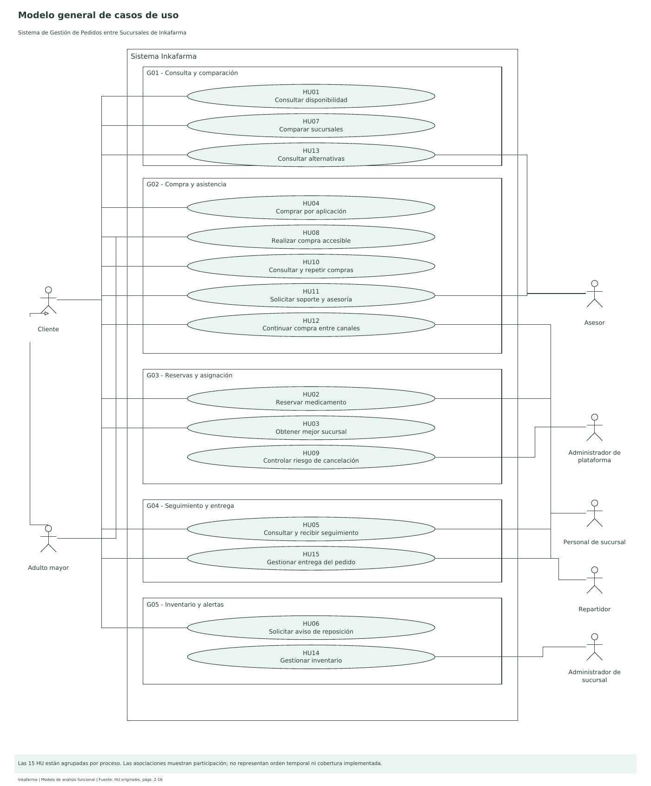
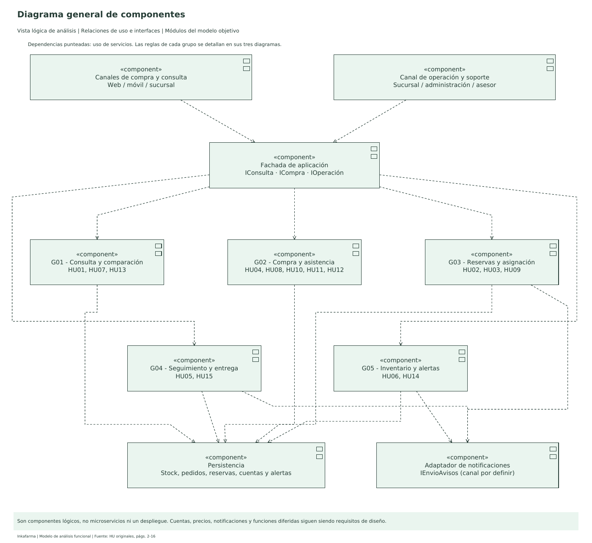

# Modelo UML de Inkafarma por grupos de historias

Modelo de análisis del **Sistema de Gestión de Pedidos entre Sucursales de Inkafarma**. Organiza las 15 historias originales en cinco procesos y conserva la relación con sus 46 criterios de aceptación.

## Entrega

- [Archivo maestro editable en diagrams.net](Inkafarma-modelo-UML.drawio): 17 pestañas.
- [PDF vectorial](Inkafarma-modelo-UML.pdf): 17 páginas con marcadores, una por diagrama.
- [Paquete completo](Inkafarma-editables.zip): maestro, archivos individuales, PDF, guía y trazabilidad.

| Tipo | Cantidad |
|---|---:|
| Modelo general de casos de uso | 1 |
| Diagrama general de componentes | 1 |
| Actividades por grupo | 5 |
| Secuencia por grupo | 5 |
| Colaboración por grupo | 5 |
| **Total de diagramas diferentes** | **17** |

Se proporcionan 18 archivos `.drawio`: 17 individuales y un maestro que reúne los mismos diagramas. Esto no agrega un diagrama al total.

## Agrupación y archivos

| Grupo | Proceso | Historias incluidas | Actividades | Secuencia | Colaboración |
|---|---|---|---|---|---|
| G01 | Consulta y comparación | HU01, HU07, HU13 | [Abrir](grupos/G01/actividades.drawio) | [Abrir](grupos/G01/secuencia.drawio) | [Abrir](grupos/G01/colaboracion.drawio) |
| G02 | Compra y asistencia | HU04, HU08, HU10, HU11, HU12 | [Abrir](grupos/G02/actividades.drawio) | [Abrir](grupos/G02/secuencia.drawio) | [Abrir](grupos/G02/colaboracion.drawio) |
| G03 | Reservas y asignación | HU02, HU03, HU09 | [Abrir](grupos/G03/actividades.drawio) | [Abrir](grupos/G03/secuencia.drawio) | [Abrir](grupos/G03/colaboracion.drawio) |
| G04 | Seguimiento y entrega | HU05, HU15 | [Abrir](grupos/G04/actividades.drawio) | [Abrir](grupos/G04/secuencia.drawio) | [Abrir](grupos/G04/colaboracion.drawio) |
| G05 | Inventario y alertas | HU06, HU14 | [Abrir](grupos/G05/actividades.drawio) | [Abrir](grupos/G05/secuencia.drawio) | [Abrir](grupos/G05/colaboracion.drawio) |

Generales: [MCU](generales/MCU.drawio) y [componentes](generales/componentes.drawio).

## Abrir y editar

1. Descarga el ZIP y extráelo.
2. Abre [diagrams.net](https://app.diagrams.net/).
3. Usa **Archivo > Abrir desde > Dispositivo** y selecciona `Inkafarma-modelo-UML.drawio`, o arrastra ese archivo al editor.
4. Cambia de diagrama con las pestañas inferiores. Cada forma, mensaje y conector es editable.
5. Guarda como `.drawio` para conservar la edición. El PDF sirve para lectura y presentación; permite ampliar sin pixelación.

## Lectura de los modelos

- **Casos de uso:** muestra los objetivos y la participación de cliente, adulto mayor, personal de sucursal, administradores, asesor y repartidor. Adulto mayor especializa a Cliente. Los grupos organizan los casos; no son actores.
- **Actividades:** contiene inicio, fin, acciones, decisiones con guardas y fusiones de caminos alternativos. Los rombos pequeños sin texto son fusiones, no decisiones adicionales.
- **Secuencia:** orden temporal de mensajes, respuestas punteadas y fragmentos `alt`, `opt`, `loop` y `break` (salida excepcional). Los participantes se mantienen en cinco por grupo para conservar legibilidad.
- **Colaboración o comunicación:** muestra la red de participantes con mensajes numerados, sin líneas de vida. Los números, operaciones y condiciones coinciden con la secuencia del mismo grupo.
- **Componentes:** vista lógica de canales, fachada, cinco módulos funcionales, persistencia y adaptador de notificaciones. Las dependencias punteadas indican uso; no implican microservicios separados.

`C1`, `C2`, etc. identifican condiciones locales de cada interacción. **No son** los criterios `CA1`, `CA2`, etc. de cada historia. La [matriz de trazabilidad](trazabilidad.csv) relaciona esos criterios con IDs de acciones del XML y números de mensajes de secuencia/colaboración.

## Fuente y decisiones de análisis

La fuente principal es el [PDF HU01-HU15](../../02-historias-usuario/HistoriasdeUsuario-Inkafarma.pdf), páginas 2 a 16. Se adapta «boticas» a **sucursales de Inkafarma**, de acuerdo con el alcance del proyecto. El reparto por grupos no elimina ninguna historia.

- G01 integra búsqueda, comparación y alternativas. La equivalencia que necesite validación profesional pasa por el asesor; no se modela una sustitución médica automática.
- G02 reúne la compra con sus variantes: accesibilidad, asistencia, repetición de pedidos y continuidad entre canales. Su participante `canal` representa la interfaz de compra elegida y el cambio de contexto entre canales; no es una integración ya implementada.
- G03 trata la reserva temporal, selección de sucursal y riesgo de cancelación. El vencimiento `T` y el plazo de confirmación son parámetros por acordar; no se fija una duración arbitraria. La reserva debe preservar stock ante concurrencia y la reasignación debe coordinar reservas e historial.
- G04 distingue domicilio y recojo. La confirmación final se registra, además de las fechas; una fecha aislada no equivale a un pedido entregado.
- G05 distingue venta, ingreso y corrección. La alerta de reposición no bloquea inventario y la disponibilidad se vuelve a comprobar al comprar.

Estos son **modelos funcionales del sistema objetivo**. Cuentas, precios, notificaciones, aplicación móvil, multicanalidad y otras funciones diferidas aparecen porque las historias las solicitan. Los diagramas no acreditan que esas funciones ya estén implementadas en el prototipo. El estado técnico se mantiene en las evidencias y planes de los sprints.

## Verificación y mantenimiento

- Las 15 HU tienen un grupo principal, sin duplicación ni omisión.
- Los 46 criterios están relacionados con acciones y mensajes existentes.
- El PDF tiene 17 páginas; el maestro tiene 17 diagramas.
- Los 18 archivos editables se validaron contra el [XSD oficial de draw.io](https://github.com/jgraph/drawio-mcp/blob/main/shared/mxfile.xsd), además de comprobar IDs y referencias de conectores.
- Se revisaron las 17 páginas renderizadas. [Inventario de diagramas](verificacion.json).

Fuentes editables del modelo: [grupos.py](../../../scripts/modelado_uml/grupos.py) y [generador](../../../scripts/modelado_uml/generar.py). Para regenerar en un entorno con Graphviz (`dot`), ReportLab y fuentes DejaVu Sans:

```bash
python -m scripts.modelado_uml.generar
```

El programa no modifica el backend, la base de datos ni las historias originales. La edición directa en diagrams.net también es válida; si se utiliza el generador después, deben trasladarse antes los cambios al modelo fuente para no perderlos.

## Vista previa de los generales




