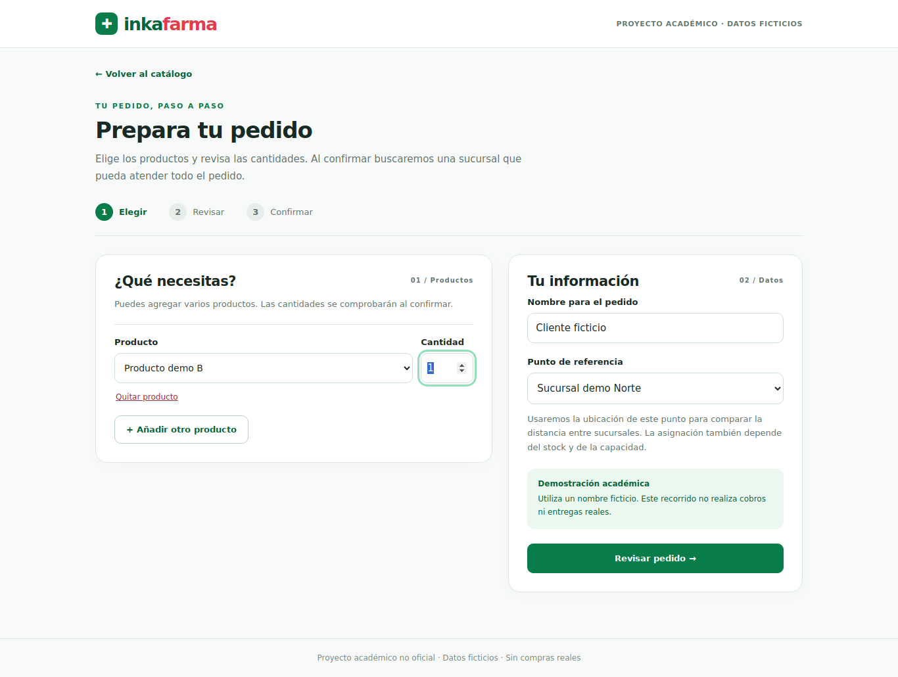
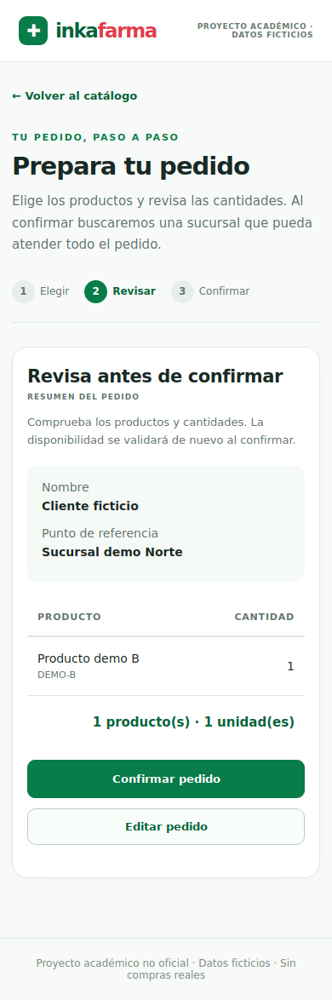
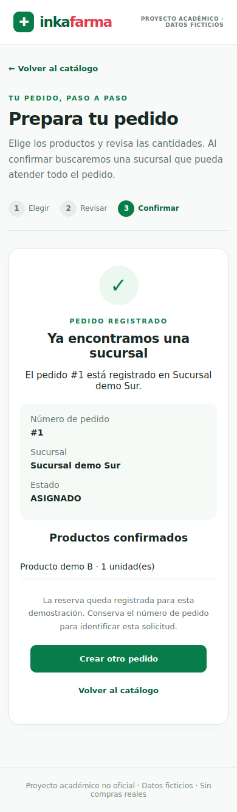

# Evidencia S2-02 — Formulario y confirmación

Tarea [#20](https://github.com/seale-code/Ingenieria-de-software/issues/20).
Fecha: 29 de octubre de 2026. Implementación local: `2cea46c`.
Python 3.12, Flask 3.1.3, Playwright 1.51.0 y Chromium Headless 134 en un entorno
de pruebas independiente. No se controló la sesión Brave del usuario.

## Resultados observados

**Suite Python/API: 147 pruebas, OK. Navegador: 6 pruebas, OK.**

- [Salida Python/API](2026-10-29_willy-api.txt).
- [Salida navegador](2026-10-29_willy-browser.txt).

Los mensajes ERROR del logger en casos de base ausente o rollback son fallos
provocados por esas pruebas; la suite terminó sin fallos ni errores de unittest.
Cada caso crea su propia SQLite temporal, con datos de seed.sql y migraciones
oficiales, y la elimina al terminar. Los escenarios E2E usan Flask HTTP y SQLite
reales, sin simular las consultas ni el servicio de registro.

| Caso | Resultado y comprobación |
|---|---|
| Formulario y opciones | GET no escribe pedidos; nombres, productos y puntos provienen de la base. |
| Cantidad inválida | 0/-1/fracciones/bool/texto/exceso: rechazo del servidor; 0 también impide avanzar en el formulario. |
| Resumen y edición | Revisar y editar mantiene cero pedidos en la base; el resumen refleja las cantidades editadas. |
| Agregar y quitar | Se eliminan líneas y se agrupan códigos repetidos antes de confirmar. |
| Confirmación válida | Reserva oficial, ID, sucursal y estado correctos en el resultado. |
| Stock insuficiente | 409 con explicación, cero pedidos; permite editar y confirmar una cantidad válida. |
| Error al cargar | Mensaje de conexión y botón de reintento; al restaurar la respuesta aparece el formulario. |
| Respuesta de confirmación perdida | El servidor ya registró; el navegador pierde la respuesta y recupera el mismo ID al reintentar; existe un solo pedido. |
| Dos POST con igual identificador | Dos conexiones simultáneas reciben el mismo resultado; una sola reserva. |
| Identificador con otros datos | 409; conserva el pedido anterior sin crear otro. |
| Dos pedidos distintos por stock limitado | Exactamente uno se registra y el otro informa falta de stock. |
| Rollback y reintento | Fallo de reserva devuelve 503 y cero pedidos; restaurar servicio permite usar la misma confirmación. |
| Base v1 o ausente | 503 genérico sin crear pedidos provisionales ni filtrar rutas internas. |
| Móvil y escritorio | Probado a 390×844 y 1366×900; sin desbordamiento horizontal; teclado y foco en los campos. |

## Capturas revisadas

## Revalidación — 30 de octubre de 2026

Parche aplicado sin conflictos sobre `main` en
`6cb0ae2c2f28afdb15766bc3fd757439fe46b69b`, con PR #36 y #40 fusionados.
Se repitieron las órdenes de la guía S2-02: **147 pruebas Python/API y 6 de
navegador aprobadas**. Se verificó la sesión `WillyCcV19` en Brave para publicar
el PR con `Closes #20`. La tarea permanece pendiente de revisión del equipo.

## Estado al preparar el parche original

Código y documentación listos localmente en
`feature/willy-s2-formulario-confirmacion`. Dependencias: PR #36 y PR #40.
El PR de la tarea #20 sigue pendiente de publicación desde la cuenta de Willy:
la conexión de Brave no estaba disponible. No se cambió la cuenta del conector
GitHub ni se publicó la tarea usando otra identidad.

Pendiente revisión del equipo; esta ejecución no acredita Sprint Review ni cierre
del sprint. Cuenta/autenticación, reserva con vencimiento, notificaciones y entrega
quedan fuera de esta tarea, como se explica en la guía S2-02.
