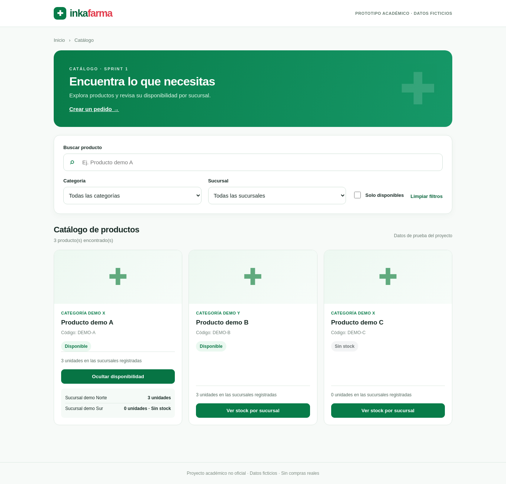

# Evidencia S3-05 — 11 de noviembre de 2026

Sebastian Calderon, tarea #17. Base remota revisada: `06211a6103c316483d866da2e103bddfe0df47f0` (main). Dependencia de preparación: PR #47, `4968c063b8c287705554343d262e7ce564ab275a`. Cada resultado «después» incluye los cambios de esta propuesta.

## Resultados

| Ejecución | Resultado | Log |
|---|---|---|
| Regresión nueva antes de corregir disponibilidad | 12 casos, 4 fallos | [Antes](s3-sebastian/regresion-antes.txt) |
| Python/API sobre main + cambios | 187 pruebas OK (175 previas + 12 nuevas) | [API](s3-sebastian/api-main.txt) |
| E2E existentes sobre main + corrección | 14 recorridos OK (8 catálogo, 6 pedidos) | [Navegador base](s3-sebastian/browser-base.txt) |
| E2E pedidos tras añadir el recorrido cruzado | 7 recorridos OK (6 previos + 1 nuevo) | [Navegador pedidos](s3-sebastian/browser-pedidos.txt) |
| Integración local de main + #47 + cambios | 198 pruebas OK (incluye 11 de preparación) | [API compuesta](s3-sebastian/api-integracion-pr47.txt) |
| Demostración técnica main + cambios | Confirmación, reserva, relación de entrega y fechas; parcial | [JSON main](s3-sebastian/demo-main.json) |
| Demostración técnica compuesta con #47 | Además preparación e historial; parcial | [JSON compuesto](s3-sebastian/demo-integracion-pr47.json) |

Las suites de navegador acreditan 15 recorridos distintos; no se suman las reejecuciones de los seis previos. Se usaron Flask, SQLite temporal y Playwright 1.51.0/Chromium. La primera ejecución de baseline detectó que faltaba Flask en el entorno; se instalaron los requisitos y la baseline real aprobó 175 casos. No se modificaron datos del usuario ni se controló su Brave.

## Defecto corregido: DISP-01

El stock HTTP ignoraba reservas ACTIVAS: al confirmar 2 de las 5 unidades, el catálogo seguía mostrando 5 disponibles y el filtro permitía mostrar artículos completamente reservados como disponibles. `get_stock(effective=True)` aplica el mismo descuento de reservas que la asignación del servicio S2 en una consulta; ambas rutas de stock/catálogo lo utilizan. Las reservas consumidas ya descontaron el inventario mediante trigger y no se restan de nuevo. Las liberadas no se restan. La consulta física por defecto sigue disponible para los servicios existentes.

La captura revisada muestra las 3 unidades restantes tras confirmar un pedido:

## Dependencias detectadas para el equipo

| Hallazgo | Responsable/tarea | Estado comprobado |
|---|---|---|
| Preparación fuera de main | César, #16 / PR #47 | Propuesta comprobada con main en worktree local; requiere revisión e integración |
| Falta seguimiento web del cliente | Willy, #15 | Sin ruta/interfaz en main revisado |
| Fechas de reparto no sincronizan estados | Anderson, #22; contrato de #19 | S3-03 guarda fechas, mantiene ASIGNADO/PREPARADO y ASIGNADA; falta servicio de transiciones |
| Permisos, incidencias y cierre de reserva | Anderson, #22 | Pendientes; no se sustituyen por SQL en la demo |
| Validación final hasta ENTREGADO | Sebastian, #17 | Bloqueada por dependencias anteriores |

No se identifican estos pendientes como fallos de pruebas ya implementadas ni se simula su aprobación. El MVP completo todavía no queda aceptado. [Guion reproducible](../../sprint-3/DEMO_MVP.md).
