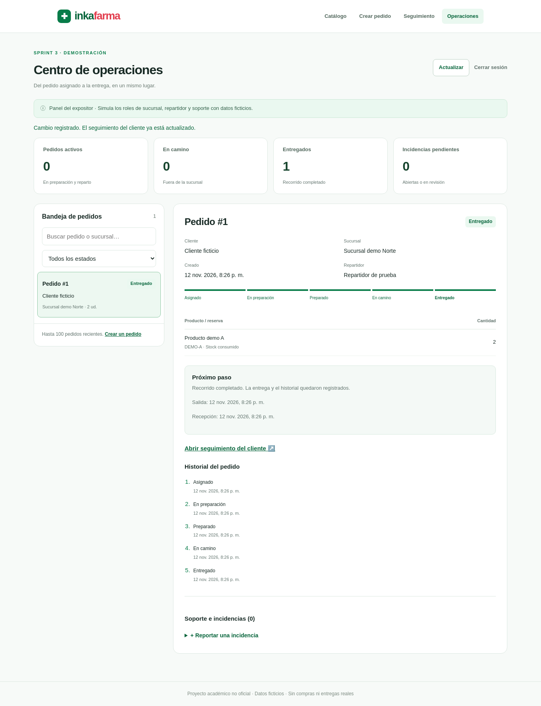
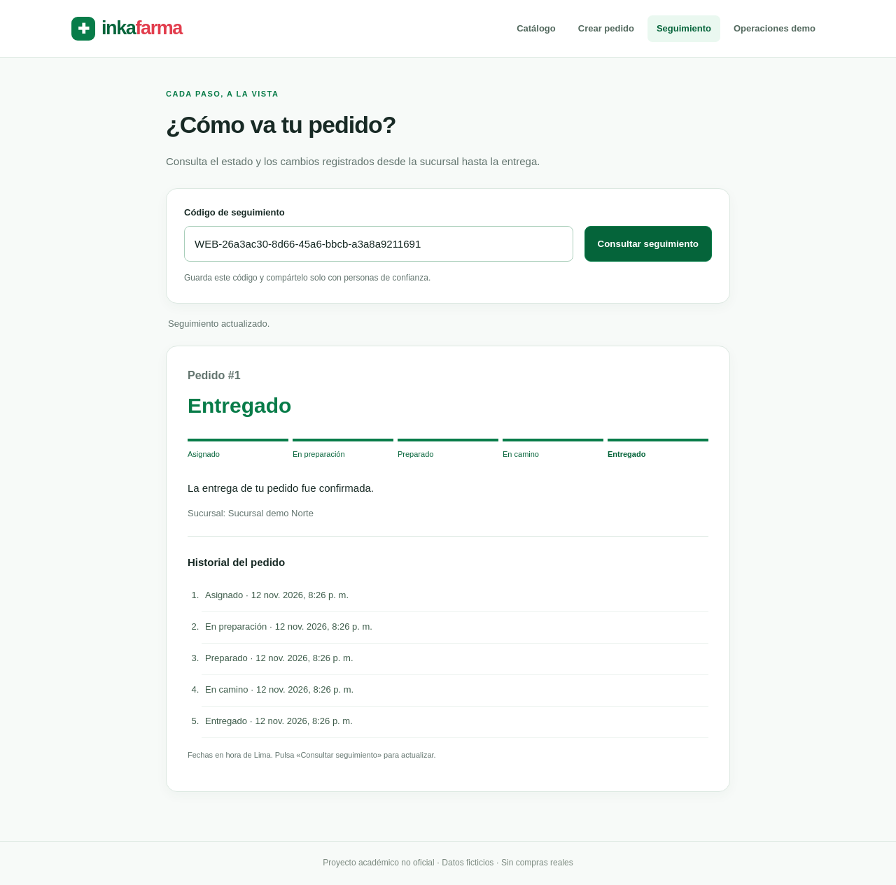
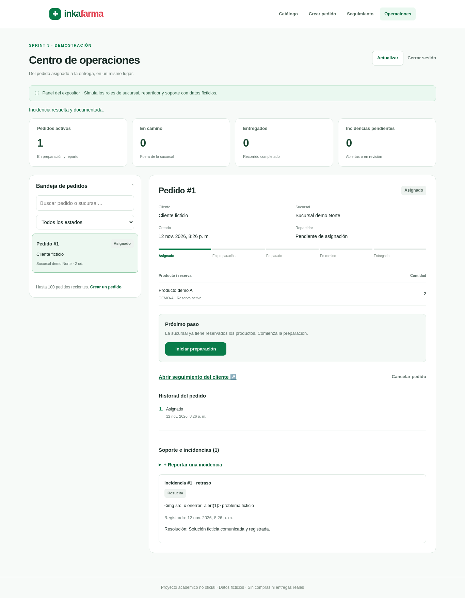
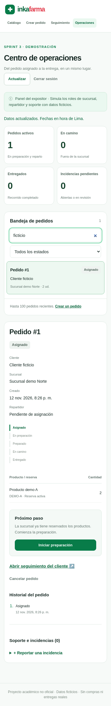

# S3-05 — Programa web integrado y validación final técnica

Fecha local: 12 de noviembre de 2026, Lima. Responsable: Sebastian Calderon (`seale-code`). Tarea [#17](https://github.com/seale-code/Ingenieria-de-software/issues/17), [Project Inkafarma](https://github.com/users/seale-code/projects/1).

Base revisada: `main` en `d8ce762a5b58f08027ca1ee5b433fecf450f89b6`, con Anderson #52 y los diagramas #53 integrados. Cambios propuestos en `feature/s3-mvp-integrado`. La aceptación por otro integrante y la Sprint Review todavía deben registrarse.

## Resultado

El programa permite completar desde el navegador: catálogo → pedido → preparación → repartidor → salida → entrega → seguimiento del cliente. El panel del expositor incluye bandeja con filtros, indicadores, productos/reservas, próximo paso, historial, cancelación confirmada e incidencias con revisión y resolución. Navegación uniforme y producto preseleccionado desde el catálogo.

El panel es una demostración local con sesión protegida y roles simulados. Permanece deshabilitado en el arranque habitual. `python -m scripts.demo_web` proporciona datos temporales v4, dos repartidores, tres pedidos y una clave nueva por ejecución.

## Verificación ejecutada

| Comprobación | Resultado | Evidencia |
|---|---|---|
| Baseline previo a esta ampliación | 236 pruebas Python/API OK | Sirvió para comprobar la integración ya existente, sin atribuir sus casos a esta entrega. |
| Suite completa Python/API | **255 casos OK**, 19 nuevos | [Log completo](mvp-web-integrado-2026-11-12/pruebas-python.log) |
| Navegador Chromium real + HTTP + SQLite | **31 recorridos OK**, 7 nuevos | [Log completo](mvp-web-integrado-2026-11-12/pruebas-chromium.log) |
| Demo técnica v4 sin navegador | **RECORRIDO_TECNICO_MVP_COMPLETO** | [Salida JSON](mvp-web-integrado-2026-11-12/recorrido-mvp.json) |
| Integridad y relaciones al finalizar | `integrity_check=ok`, sin errores de claves foráneas | Mismo recorrido reproducible |
| Diseño adaptable | 320, 390 y 1366 px sin desbordamiento en el panel; catálogo, formulario y seguimiento conservan sus casos anteriores | Pruebas de navegador y capturas |
| Arranque real del comando de demo | HTTP OK, seis productos y acceso con clave temporal | Proceso iniciado y detenido con SIGINT; clave omitida de la evidencia |
| Sintaxis y parches | Compilación Python, `node --check` y `git diff --check` correctos | Comprobados sobre la propuesta |

Python 3.12, Flask 3.1.3 y Playwright 1.51.0; Chromium Headless Shell 134/build 1161. Dependencias instaladas desde `requirements-test.txt`. Cada caso usa una base temporal y un servidor HTTP local; no se usaron pedidos ni clientes reales.

Se observó y corrigió un defecto de la nueva interfaz durante las pruebas: después de iniciar sesión sobre una base sin pedidos, el detalle quedaba en blanco. La vista vacía ahora ofrece crear un pedido y se comprobó su actualización al aparecer el primero.

## Stock y operaciones consistentes

La demostración técnica parte del fixture estándar: 5 unidades físicas de DEMO-A en Norte. Confirmar 2 deja 3 disponibles y mantiene 5 físicas. Al salir, la reserva pasa a CONSUMIDA y quedan 3 físicas/disponibles; confirmar la entrega conserva esas cantidades. Una segunda solicitud de una unidad, cancelada antes de salir, vuelve a dejar 3 disponibles sin consumo adicional.

Los pasos públicos del reparto anterior separaban fecha y transición. La nueva acción web los guarda juntos: un error no deja una fecha de salida que impida cancelar ni una recepción sin entrega confirmada. Dos pruebas inyectan errores SQLite durante esas operaciones y comprueban rollback de fecha, pedido, entrega, reservas e historial. Cuatro salidas concurrentes consumen una sola vez. Los comandos anteriores siguen disponibles con su contrato original.

El seguimiento presenta exactamente ASIGNADO, EN_PREPARACION, PREPARADO, EN_CAMINO y ENTREGADO; la entrega termina ENTREGADA. Se verifican también la cancelación antes de salir, el bloqueo después de salir, la incidencia ABIERTA → EN_REVISION → RESUELTA y la explicación de resolución.

## Controles y límites de seguridad comprobados

| Riesgo considerado | Control verificado | Límite real |
|---|---|---|
| Acceso a datos internos desde el cliente | Panel y API internos deshabilitados por defecto; sesión con clave cuando se habilitan; 401 sin sesión | Es una sesión de expositor local; no hay cuentas ni permisos individuales de empleados. |
| Peticiones de otro sitio o cambios sin autorización | JSON, comprobación de origen y CSRF en escrituras; token anterior o malformado rechazado | La demo escucha solo en localhost; un despliegue público requeriría otro diseño de autenticación y operación. |
| Rol o actor elegidos en el navegador | Los campos extra `rol`/`actor_id` se rechazan; el servidor selecciona el actor de la entrega | El expositor está autorizado a simular los distintos roles, no a demostrar identidad real de un repartidor. |
| Stock consumido dos veces o cambios a medias | Transacción única, validación de reservas y reintentos sin efecto adicional | Las funciones CLI de fechas permanecen independientes, como antes. |
| Exposición de datos por seguimiento | Código en cabecera, fragmento retirado, no-store y respuesta sin nombre/ubicación/observaciones | El código privado permite consultar el estado; no sustituye una cuenta autenticada. |
| HTML escrito como descripción | DOM con `textContent`; una descripción `` se muestra literalmente | Verificación acotada de los casos probados, no una auditoría o certificación de seguridad completa. |
| Mensajes que revelan rutas o errores SQL | 503 genérico y cabeceras nosniff/no-referrer/DENY | Faltan los controles de operación de un servicio de producción. |

El registro de incidencias no incorpora una clave de idempotencia: ante respuesta incierta hay que actualizar antes de repetir. El borrador del formulario tampoco se recupera tras recargar la pestaña. No se implementan precios, pagos, GPS, notificaciones push ni canales externos.

## Capturas inspeccionadas

### Panel y pedido entregado

### Seguimiento del cliente

### Incidencia resuelta

### Vista móvil

[Catálogo revisado](mvp-web-integrado-2026-11-12/catalogo-1366.png) · [Guion y comandos](../../sprint-3/DEMO_MVP.md).

Las capturas utilizan datos ficticios y códigos de bases temporales ya eliminadas. No contienen la clave del panel. Las fechas ISO del log pueden corresponder al día siguiente en UTC; las pantallas convierten a Lima.
