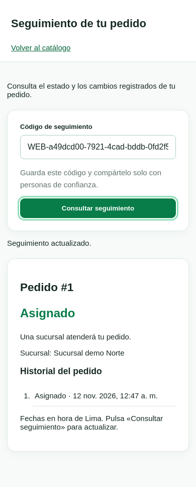
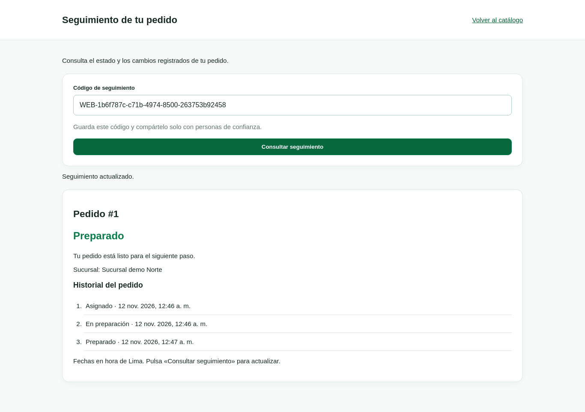

# S3-05 — Ampliación de validación del seguimiento

Sebastian Calderon (`seale-code`), tarea #17. Revisión del 12 de noviembre de 2026 sobre el seguimiento de Willy: PR #49, `9f41300ef21654ca78686fce8790a1bb2a0eead1`, más los cambios de esta ampliación. Main revisado: `ba028b5aec67359b68bc6690094a45d3ebb5970a`, que ya incluye #47 y #48.

## Resultado

| Comprobación | Resultado | Evidencia |
|---|---|---|
| Baseline de la propuesta de Willy | 205 pruebas Python/API OK | Referencia antes de añadir los casos de integración |
| Suite Python/API ampliada | **211 pruebas OK** | [Log](s3-seguimiento/api.txt) |
| Suite completa de navegador | **24 recorridos OK**: 8 catálogo, 7 pedidos, 9 seguimiento | [Log](s3-seguimiento/browser.txt) |
| Demo técnica | Preparación e historial coherentes con API de seguimiento | [JSON](s3-seguimiento/demo.json) |
| Sintaxis JavaScript y diff | `node --check` de pedido.js; `git diff --check` correctos | Verificación local |

Python 3.12, Flask 3.1.3 y Playwright 1.51.0/Chromium. SQLite temporal y servidor HTTP real para navegador. No se usó el Brave del usuario. La comprobación de portapapeles bloqueado simula el rechazo de la API; el caso de copia correcta sí utiliza el portapapeles del navegador de pruebas.

## Funcionalidad ampliada

La confirmación permite copiar el código de seguimiento y muestra una alternativa manual si el navegador rechaza la copia. Al crear otro pedido, cambia el código y el enlace apunta al nuevo pedido. El código no se persiste automáticamente en almacenamiento local.

La demo `python -m scripts.validar_mvp` invoca las funciones reales de preparación y consulta `/api/seguimiento` con el código del pedido confirmado. Comprueba que número, estado e historial coincidan; no avanza estados con SQL ni presenta la recepción de una fecha como entrega concluida.

## Escenarios ejecutados

- Confirmación web → enlace → seguimiento del mismo pedido, código enviado por cabecera y fragmento eliminado de la barra.
- Preparación real: ASIGNADO → EN_PREPARACION → PREPARADO; al actualizar se reflejan estado e historial en orden.
- Cantidades y reservas mantienen las pruebas de regresión del catálogo.
- Código mal formado o inexistente: mensaje claro, sin resultado viejo; corrección y reintento funcionan.
- Desconexión y HTTP 503: mensaje, controles recuperables y actualización posterior correcta.
- Petición en carga: botón deshabilitado y campo de código de solo lectura.
- Respuesta perdida tras confirmar: mismo UUID, un pedido y una reserva, seguimiento recuperado.
- Anchos 390 y 1366: sin desbordamiento horizontal; navegación por teclado.
- API pública sin cliente, coordenadas ni observaciones internas; consulta sin duplicar escrituras y salto de preparación rechazado sin historial falso.

## Capturas revisadas

También se conserva la [vista de escritorio](s3-seguimiento/seguimiento-1366.png). Los códigos y pedidos de las capturas pertenecen a bases ficticias temporales ya eliminadas.

## Estado del MVP

La preparación ya está integrada; el seguimiento de Willy está propuesto en #49 y queda verificado técnicamente con esta ampliación. No se fusionaron ramas remotas durante la revisión. El recorrido final hasta ENTREGADO, los permisos, las incidencias y la coordinación con las reservas todavía dependen de #22. Los resultados no acreditan una reunión de aceptación ni el cierre del Sprint 3.
