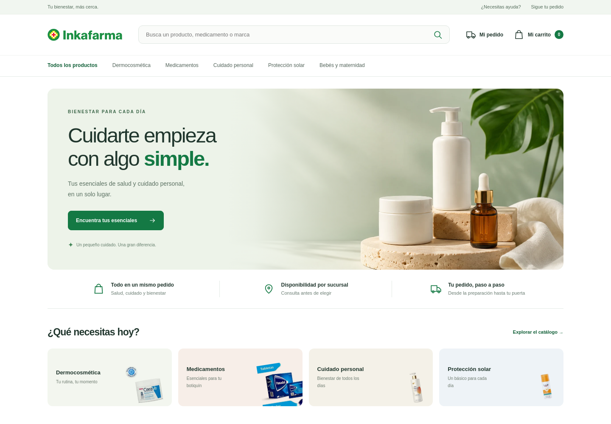
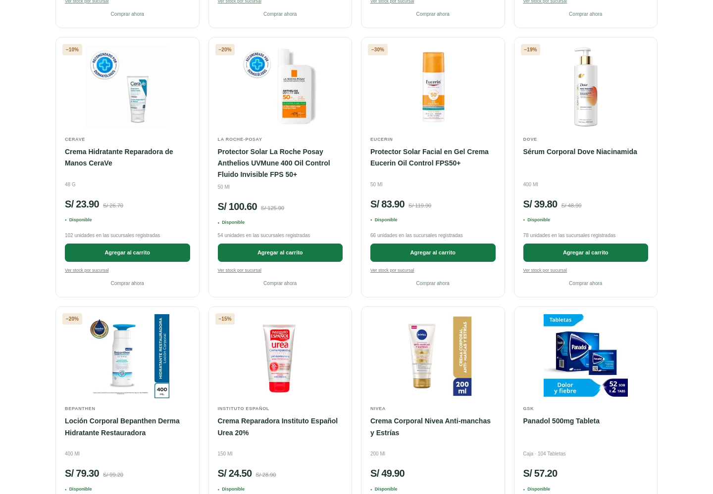
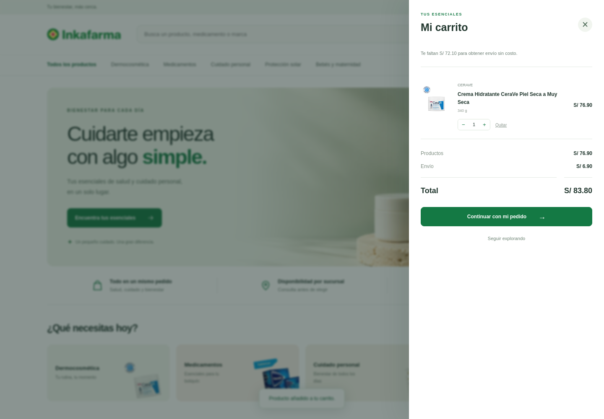
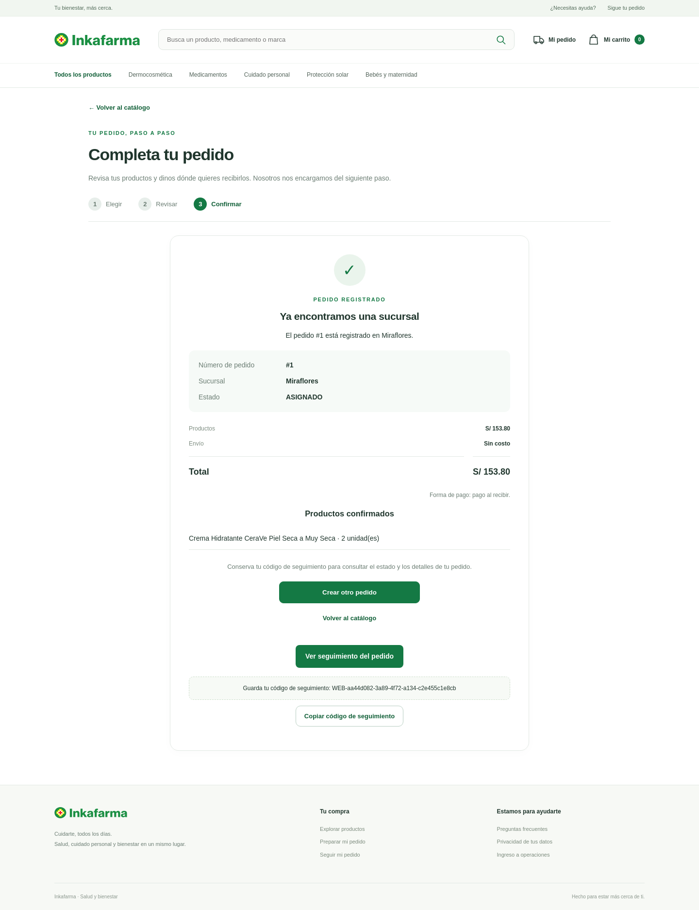

# Producto comercial — catálogo, carrito y entrega

Fecha: 13 de noviembre de 2026 (Lima). Tarea [#17](https://github.com/seale-code/Ingenieria-de-software/issues/17), [Project Inkafarma](https://github.com/users/seale-code/projects/1). Base: `main` en `a51ba87`, con el PR #54 integrado. Rama: `feature/catalogo-comercial-profesional`.

## Resultado de la revisión

Se presenta una tienda consistente desde la portada hasta el pedido entregado. Se sustituyen las tarjetas de productos genéricos por 16 referencias comerciales con imágenes, marcas, presentaciones y precios. La portada incluye fotografía original, categorías, navegación y acceso al carrito. Las pantallas de compra, seguimiento, operaciones, ayuda y privacidad comparten la identidad y utilizan textos comerciales.

El carrito conserva cantidades, permite agregar/quitar productos y muestra subtotal, envío y total. La revisión del pedido solicita celular, dirección y distrito; la confirmación conserva precios en servidor. El método disponible es pago al recibir y no se marca el pedido como pagado al confirmarlo.

## Verificación ejecutada

| Comprobación | Resultado | Evidencia |
|---|---|---|
| Suite Python/API | **276 casos aprobados**; 21 nuevos casos comerciales | [Log](tienda-comercial-2026-11-13/pruebas-python.log) |
| Navegador Chromium, HTTP y SQLite | **38 recorridos aprobados**; 7 nuevos recorridos de tienda | [Log](tienda-comercial-2026-11-13/pruebas-chromium.log) |
| Compra hasta entrega | Carrito, cotización, confirmación, preparación, asignación, salida, entrega y seguimiento correctos | Caso `test_carrito_checkout_y_operaciones_hasta_entregado` |
| Importes y reintentos | Precio cambiado exige revisión; pedido confirmado conserva importes; cuatro confirmaciones concurrentes generan un pedido | Pruebas `test_comercio.py` |
| Error al guardar precios | Rollback de pedido, reservas, historial e importes | Fallo SQLite inyectado en la escritura financiera |
| Privacidad | Dirección/celular solo en operaciones; no se guardan en el carrito ni se devuelven en seguimiento | Casos API y navegador |
| Fotografías y recursos | 16 fotos de producto, marca y portada locales; sin solicitudes externas al recorrer la tienda | Caso de fotografías y vistas adaptables |
| Vistas adaptables | 320, 390 y 1440 px, sin desbordamiento horizontal del documento | Capturas y comprobaciones del navegador |
| Arranque real y reinicio | 16 productos, acceso operativo y reserva conservada después de detener/iniciar el comando | [Resultado](tienda-comercial-2026-11-13/arranque-reinicio.json) |
| Compatibilidad | La migración conserva pedidos y reservas v4; la suite previa continúa aprobada | Casos de migración e integración anteriores |

Python 3.12, Flask 3.1.3, Playwright 1.51.0 y Chromium Headless Shell 134/build 1161. Las pruebas usan bases temporales independientes. Las claves del panel se omiten de logs y capturas. Tras verificar el filtrado de productos sin configuración comercial, se repitieron los siete recorridos de tienda: [log final específico](tienda-comercial-2026-11-13/pruebas-tienda-final.log). El formato final del CSS se volvió a comprobar en los tres tamaños de pantalla.

Dos casos de navegador anteriores se adaptaron a la nueva navegación: el acceso del catálogo al formulario utiliza el enlace del pie de página, y el tabulador desde la búsqueda llega primero a su botón. Se mantiene la comprobación de navegación por teclado entre los filtros.

## Consistencia comercial

- El precio mostrado corresponde a la presentación indicada. Panadol se carga como caja de 104 tabletas por S/ 57.20; no se usa su precio fraccionado para una caja completa.
- Los totales se calculan en céntimos enteros. Se cobra S/ 6.90 de envío por debajo de S/ 149.00; desde ese importe es sin costo.
- El cliente no decide precios, envío ni coordenadas del distrito. El servidor resuelve y valida estos valores.
- Pedido, reserva, precio por línea y datos comerciales se guardan en una sola transacción.
- Actualizar el catálogo no cambia el importe de una compra confirmada. Reintentar la confirmación no genera otra reserva.
- El arranque usa una base persistente propia y no reemplaza el stock o los precios operados.

[Fuentes, reglas y contrato comercial](../CATALOGO_COMERCIAL.md). Las referencias se consultaron en páginas públicas de Inkafarma el 13 de noviembre de 2026; las imágenes de portada y de producto tienen funciones distintas y su procedencia queda documentada.

## Capturas revisadas

### Portada



### Catálogo



### Carrito



### Pedido confirmado



[Vista móvil](tienda-comercial-2026-11-13/tienda-390.png) · [Seguimiento entregado](tienda-comercial-2026-11-13/seguimiento-comercial.png).

## Repetir la ejecución

```bash
python -m pip install -r requirements-test.txt
python -m unittest discover -s tests -v
python -m playwright install chromium-headless-shell
python -m unittest discover -s tests/e2e -v
```

Para abrir el producto: `python -m scripts.iniciar_tienda`. No se ejecutaron cobros ni se contactó a clientes o repartidores durante las pruebas; los recorridos ejercitan los servicios locales del proyecto.
