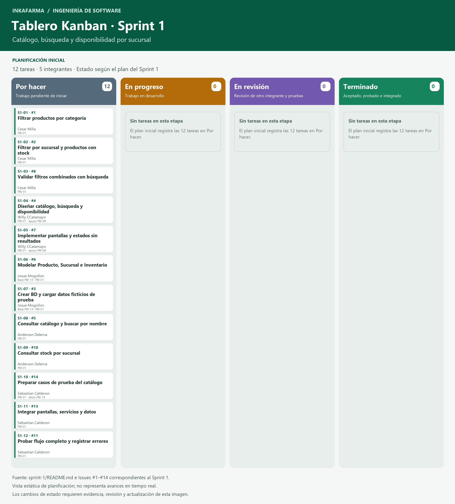

# Scrum — PBI, Product Backlog, priorización y tablero

[← Documentación](../README.md) · [Sprint 1](../../sprint-1/README.md) · [Tablero Kanban en PNG](tablero-kanban-sprint-1.png)

## Qué presentar

1. [Product Backlog y sus 15 PBI](PRODUCT_BACKLOG.md): qué necesita el producto, de qué historia sale cada elemento y cómo se aceptará.
2. [Priorización MoSCoW](PRIORIZACION.md): qué se considera indispensable y por qué se ordenó así.
3. [Sprint Backlog 1](SPRINT_BACKLOG_1.md): qué parte se seleccionó y cómo se descompone en las 12 tareas existentes.
4. [Tablero y reglas de avance](TABLERO.md): dónde seguir las tareas y cuándo cambiar su estado.

## Cómo se relacionan

**Historia de usuario → PBI del Product Backlog → selección para el sprint → tareas en Issues → seguimiento en el tablero Kanban → revisión con evidencias.**

Un **PBI (Product Backlog Item)** es un elemento del trabajo del producto. En este backlog se usa un PBI por historia original para conservar su trazabilidad; durante el refinamiento puede dividirse.

El **Product Backlog** reúne y ordena el trabajo del producto. El **Sprint Backlog** contiene el objetivo, la selección y el plan de trabajo de un sprint. Por eso, las 12 tareas del Sprint 1 no equivalen a 12 historias de usuario.

## Fuentes y estado de la planificación

- [Historias originales HU01–HU15, páginas 2–16](../02-historias-usuario/HistoriasdeUsuario-Inkafarma.pdf).
- [Alcance actual del proyecto](../../README.md): sucursales de Inkafarma.
- [Plan Sprint 1](../../sprint-1/README.md), [Sprint 2](../../sprint-2/README.md) y [Sprint 3](../../sprint-3/README.md).
- [Issues principales de los tres sprints](https://github.com/seale-code/Ingenieria-de-software/issues?q=is%3Aissue+Sprint+in%3Atitle).

Los resúmenes de los PBI se derivan del PDF; las prioridades y el orden son una **propuesta de planificación pendiente de validación por el equipo/Product Owner**. No hay estimaciones ni fechas acordadas. La documentación no acredita funcionalidades implementadas.

El archivo [REQUISITOS.md](../01-requisitos/REQUISITOS.md) contiene además ventas, roles y recojo. Es necesario conciliarlo con las historias y el alcance actual antes de incorporar nuevos compromisos al sprint.
