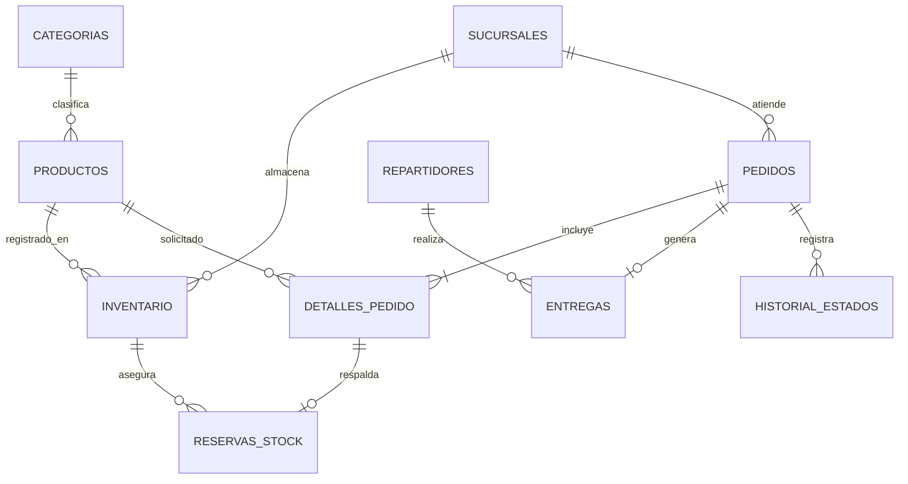

# Modelo de datos de Josue — S2-03 y S3-03

## 1. Diagrama entidad–relación

El Sprint 1 ya ofrece `categorias`, `productos`, `sucursales` e `inventario`. **No se reemplazan**: se agregan las entidades del Sprint 2 y 3 mediante migraciones.

*La relación de pedido con detalle es obligatoria desde el negocio; el esquema permite crear un encabezado momentáneamente sin detalle dentro de una transacción para que el backend inserte el detalle a continuación.*

## 2. Sprint 2 — Pedidos y reservas

| Tabla | PK | Relaciones y reglas |
|---|---|---|
| `pedidos` | `id` | `sucursal_id` → `sucursales`. `codigo` único. Estado y fecha de creación. |
| `detalles_pedido` | `id` | `pedido_id` → `pedidos`; `producto_id` → `productos`. Cantidad positiva, combinación pedido/producto única. |
| `reservas_stock` | `id` | `(pedido_id, producto_id)` → `detalles_pedido`; `(pedido_id, sucursal_id)` → `pedidos`; `(producto_id,sucursal_id)` → `inventario`. Cantidad coincidente con detalle y reservas activas no mayores al inventario. |

### Invariantes de reserva

- **Disponible para nueva reserva** = `inventario.cantidad - SUM(reservas_stock.cantidad de reservas ACTIVA)` del mismo producto y sucursal.
- Una reserva se inserta solo como `ACTIVA`. Puede pasar a `LIBERADA` o `CONSUMIDA`, con fecha de cierre; no se borra ni se reactiva.
- Al pasar a `CONSUMIDA` el trigger descuenta `inventario.cantidad` una vez. Al liberar no descuenta.
- Si el inventario se intenta reducir por debajo de reservas activas, SQLite rechaza la operación.
- El backend debe crear `pedidos`, `detalles_pedido` y `reservas_stock` en **una misma transacción**, preferiblemente `BEGIN IMMEDIATE`.
- Las reglas de vencimiento y re-reserva quedan pendientes de aprobación del equipo.

## 3. Sprint 3 — Entregas e historial

| Tabla | PK | Relaciones y reglas |
|---|---|---|
| `repartidores` | `id` | `codigo` único, nombre no vacío, activo booleano. |
| `entregas` | `id` | `pedido_id` → `pedidos` (**una entrega por pedido** en este MVP), `repartidor_id` → `repartidores`. Fechas de asignación, salida y entrega; estado. |
| `historial_estados` | `id` | `pedido_id` → `pedidos`. Estado previo, nuevo, fecha, observación. Inmutable. |

El historial se crea automáticamente al insertar o cambiar `pedidos.estado`, y se rellena con el estado actual de los pedidos preexistentes al migrar a v3. **Importante**: las transiciones permitidas, la sincronización entre estado de pedido y entrega y los permisos de usuario son decisiones funcionales del equipo/S3-04; esta migración no las da por resueltas.

## 4. Operaciones y ejemplos de aceptación

**Reserva correcta:** Producto ficticio con stock 5 en sucursal A. Pedido 1 solicita 3. Se crea la reserva de 3.

**Sobreventa rechazada:** Un segundo pedido intenta reservar 3 unidades más del mismo producto en la misma sucursal. El trigger rechaza la segunda operación porque 3+3 > 5.

**Liberación:** Pedido 1 libera su reserva: la capacidad disponible vuelve a 5, sin disminuir inventario físico.

**Consumo:** Pedido 1 consume su reserva de 3 unidades: inventario físico pasa de 5 a 2.

**Entrega e historial:** Pedido 1 se enlaza con un repartidor, se registra salida y confirmación de entrega. Los cambios de `pedidos.estado` quedan en `historial_estados` con sus fechas.
